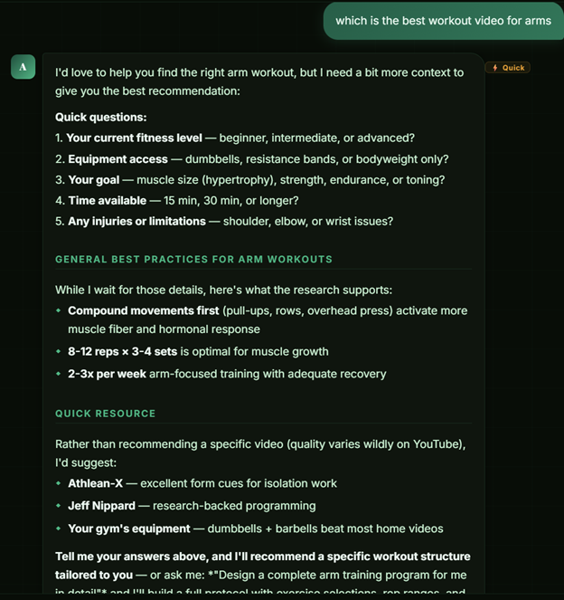
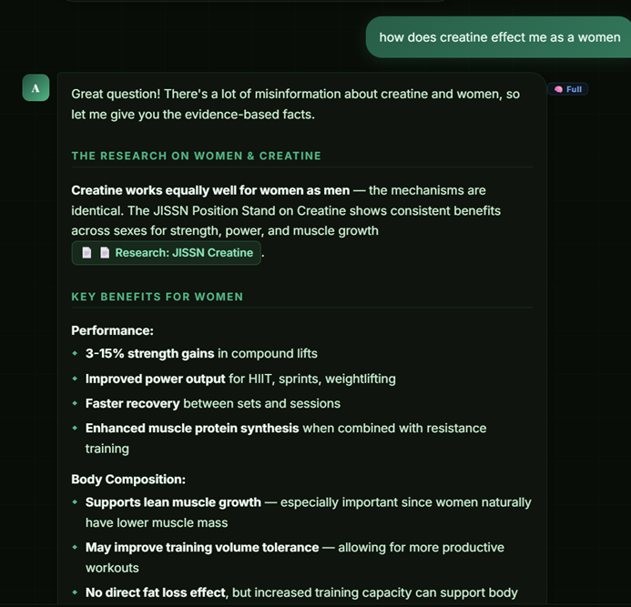

# AILARA — AI Health & Fitness Coaching Platform

> **Live App:** [ailara.app](https://ailara.app)

An AI health coaching web app built solo from concept to deployed product. AILARA provides personalized guidance across fitness, nutrition, supplementation, and wellness, powered by Claude.


---

## What It Does

Users get a personal AI health coach that:

- **Answers fitness and nutrition questions**, with source citations (Pro)
- **Builds custom workout programs** tailored to their goals, equipment, and schedule, linked to a library of 1,800+ workout videos
- **Generates personalized meal plans** from a library of 500+ recipes, with dietary-restriction filters
- **Tracks supplements, habits, and progress** with trend analytics and weight logging
- **Logs actions from chat**: the coach can log workouts, weight, and habits through tool calls

---

## Technical Architecture

### Frontend
- **React 18**: single-file component architecture (`src/App.jsx`, ~13,500 lines)
- **Vite**: compiled for production
- **PWA**: installable via "Add to Home Screen", offline-capable via a service worker
- Mobile-first responsive design
- **No accounts and no database.** All user data (profile, chat history, logs, meal plans) lives in the browser's `localStorage` through `src/storagePolyfill.js`. Data is per-device.

### AI
- **Model:** every AI call uses `claude-sonnet-5` (coach chat with tool calling, profile plan, meal plans, workout programs).
- **System prompt:** the coach prompt is large (~220 KB, on the order of 55k tokens) and is sent with every coach message. The proxy forwards the prompt-caching beta header, but the app does not currently mark any content with `cache_control`, so prompt caching is **not** active. Adding it is the biggest available cost reduction.
- **No model routing.** There is no cheap-model/expensive-model classifier.

### Security
What exists:
- **Server-side API proxy** (`api/chat.js`): the Anthropic key never reaches the browser.
- **Proxy hardening** (anonymous app, so this is abuse-resistance, not user authentication):
  - requests must carry an `Origin` header matching this site (browsers always send it on POST); anything else gets `403` and never reaches Anthropic. Note a script can forge this header, so it raises the bar but is not a guarantee;
  - model allowlist (`claude-sonnet-5`, `claude-haiku-4-5-20251001`);
  - `max_tokens` capped at 4000, message count, system-prompt size, and tool names validated;
  - best-effort per-IP rate limit (30/min, 300/hour per server instance);
  - generic error responses; token usage and approximate cost logged per request.
- AI output is rendered through React (no `dangerouslySetInnerHTML` anywhere in the app).

Known limitations (not yet addressed):
- No user authentication, because there are no accounts. A determined attacker who forges headers and rotates IPs can still use the proxy; the Anthropic console spend limit and a platform-level rate limit/bot rule are the backstops.
- The client sends the system prompt, so a forged request can supply its own prompt (bounded by the caps above). Moving prompts server-side would close this.
- No prompt-injection filtering and no output sanitization beyond React's escaping.
- The `update_profile` tool will write any profile field the model names; there is no field allowlist.
- Tool calls execute in the browser.

### Backend / Deployment
- **Vercel**: static hosting plus one serverless function (`/api/chat`), automatic deploys from GitHub.
- Set `ANTHROPIC_API_KEY` in the Vercel project's environment variables.

### Payments
**Not implemented.** The upgrade screen shows Pro ($4.99/mo) and Elite ($12.99/mo), but tapping "Upgrade" only sets a flag in `localStorage`; no payment is taken and nothing is enforced server-side. Anyone can set the flag themselves. Real billing needs accounts plus a payment provider (for example Stripe) with server-side verification.

---

## Tiers (as currently coded in the app)

| Feature | Free | Pro / Elite* |
|---------|------|-----|
| AI coach messages | 5 per day | Unlimited |
| Meal plan generations | 1 | Unlimited |
| Custom AI workout programs | No | Yes |
| Source citations on answers | No | Yes |
| Image analysis | No | Yes |
| Progress tracker, supplements, nutrition hub, workout library | Yes | Yes |

\*Elite's extra features (wearable sync, proactive check-ins, recovery coaching) are listed as "coming soon" and are not built.

These limits are enforced in the browser only.

---

## Cost

There is no verified cost model. Rough guidance from the code: each coach message sends the ~55k-token system prompt uncached, and a message that triggers a tool call makes two API calls. At the rate the proxy assumes for its logging ($3 per million input tokens), the system prompt alone is about $0.16 per call. Use the per-request cost lines in the Vercel function logs for real numbers.

---

## Project Structure

```
ailara-web/
├── api/
│   └── chat.js          # Vercel serverless proxy — holds the API key server-side
├── src/
│   ├── App.jsx          # The whole app
│   ├── main.jsx         # React entry
│   └── storagePolyfill.js  # window.storage backed by localStorage
├── tests/
│   └── chat.test.mjs    # Proxy hardening tests (npm test)
├── assets/ icons/ Screenshots/
├── index.html           # App shell
├── manifest.json        # PWA manifest
├── sw.js                # Service worker
├── privacy.html terms.html
└── vercel.json          # Routing + security headers
```

---

## Key Engineering Decisions

**Why a single-file React component?**
It started as a Claude.ai artifact for rapid prototyping and was shipped as is. It works, but the file is very large; splitting it is future work.

**Why a serverless proxy?**
It keeps the API key off the client with no server to manage.

**Why PWA over native app?**
Faster to market, no App Store review, works on iOS and Android.

---

## Running Locally

```bash
git clone https://github.com/andrewmiller5041-boop/ailara-web.git
cd ailara-web
npm install

# Set your Anthropic API key (see .env.example)
cp .env.example .env   # then fill in ANTHROPIC_API_KEY

# Serves both the app and the /api/chat proxy
npx vercel dev
```

Open `http://localhost:3000`. Run the proxy tests with `npm test`.

---

## Deployment

Pushing to `main` deploys to production through the Vercel GitHub integration. Set `ANTHROPIC_API_KEY` in Vercel → Settings → Environment Variables.

---

## Built By

**Andrew Miller**
AI Engineer · Supply Chain Senior Consultant · U.S. Army Officer
[LinkedIn](https://linkedin.com/in/andrew-miller-56115a20a) · [andrewmiller5041@gmail.com](mailto:andrewmiller5041@gmail.com)

---

## License

MIT — feel free to fork and adapt.
